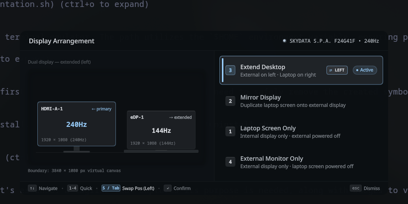

# hypr-display-switcher

<p align="center">
  <b>A tactile, hardware-agnostic display manager and presentation switcher overlay for Hyprland.</b><br>
  Built with <a href="https://github.com/quickshell-mirror/quickshell">Quickshell</a> (QML) and Bash.
</p>

<p align="center">
  
  
  
  
</p>

---

## Overview

Most display switchers on Wayland rely on hardcoded monitor names, fixed resolution arguments, or brittle shell scripts. 

**hypr-display-switcher** is a studio-grade display arrangement overlay designed specifically for **Hyprland**. It parses your system's hardware topology dynamically via `hyprctl monitors -j`, renders a physical spatial canvas with real-time proportions, and lets you swap multi-monitor positions (Left ⇄ Right ⇄ Top) or switch to presentation duplicate mode with a single keystroke.

<p align="center">
  
</p>

---

## Key Features

* **100% Dynamic Hardware Detection:**
  * Zero hardcoded hardware strings, monitor names, ports, or refresh rates.
  * Automatically identifies internal panels (`eDP`, `LVDS`, `DSI`) and pairs them with any connected external display (HDMI, DisplayPort, USB-C/Thunderbolt).
  * Automatically detects highest supported native resolution and maximum refresh rate (e.g., 240Hz, 165Hz, 144Hz, 60Hz).

* **Quick Position Swap (`S` / `Tab`):**
  * Instant external display relocation in Extend Desktop mode:
    $$\text{Left (Kiri)} \longleftrightarrow \text{Right (Kanan)} \longleftrightarrow \text{Top (Atas)}$$
  * Toggle positions with `S`, `s`, `Tab`, `Shift+Tab`, or click the interactive `[⇄ LEFT/RIGHT/TOP]` pill badge.

* **Physical Spatial Canvas:**
  * Real scale-proportional dual-display representation.
  * Monitors physically slide past each other during position changes.
  * In **Top** mode, monitors gracefully scale to $0.82\times$ and stack vertically above the desk baseline with real-time calculated canvas dimensions (`Boundary: 1920 × 2160 px stacked canvas`).

* **Optical Projector Aperture & Light Beam (Mirror Mode):**
  * Minimalist hardware projector visualization with optical lens aperture, power LED, and a radiant projection beam directed onto the source laptop display.

* **Snappy Physical Transitions:**
  * Strictly calibrated 160–180ms animations with `Easing.OutCubic` curves for instantaneous, tactile feedback.

* **Failsafe ICC Color Calibration Support:**
  * Automatically searches and applies custom color calibration profiles (`.icm` / `.icc`) if present in `~/.config/hypr/profiles/` or `~/.local/share/icc/`.
  * Fails gracefully without errors or warnings if no profile is installed.

* **Full Keyboard & Mouse Ergonomics:**
  * Comprehensive keyboard navigation (`1-4`, `↑ / ↓`, `Enter`, `Tab`, `S`, `Esc`).
  * Full mouse hover states, interactive mode selection, and quick-swap chip clicking.

* **Adaptive Studio Color Palette:**
  * Automatically inherits system palette tokens from Serpantinum / Matugen state files (`qs_colors.json` / `qs_matugen_colors.json`) with refined dark studio fallbacks.

---

## Requirements

Ensure the following packages are installed on your system:

| Dependency | Purpose | Package Name |
| :--- | :--- | :--- |
| **Hyprland** | Wayland Compositor & IPC | `hyprland` |
| **Quickshell** | QML Layer-Shell Overlay Engine | `quickshell` *(or `quickshell-git`)* |
| **jq** | JSON parser for monitor detection | `jq` |
| **libnotify** | Desktop mode notification banners | `libnotify` (`notify-send`) |
| **Nerd Font** | Keycap glyphs & icon typography | `ttf-cascadia-cove-nerd` *(or any Nerd Font)* |

### Package Installation

```bash
# Arch Linux
sudo pacman -S hyprland jq libnotify ttf-cascadia-cove-nerd
# Quickshell (from AUR)
yay -S quickshell-git

# Fedora
sudo dnf install hyprland jq libnotify
```

---

## Installation

### Automated Install (Recommended)

Clone the repository and run the automated installer:

```bash
git clone https://github.com/<your-username>/hypr-display-switcher.git
cd hypr-display-switcher
chmod +x install.sh
./install.sh
```

The installer will:
1. Validate all required system dependencies.
2. Back up any existing files safely.
3. Create symlinks to `~/.config/hypr/display-switcher/` and `~/.config/hypr/scripts/`.
4. Provide ready-to-copy keybinding snippets for your Hyprland configuration.

---

## Hyprland Keybinding Configuration

Add the following keybinds to your Hyprland configuration file:

### Standard Configuration (`~/.config/hypr/hyprland.conf`)

```ini
# Display Switcher GUI Overlay (Super + Shift + P)
bind = $mainMod SHIFT, P, exec, ~/.config/hypr/scripts/toggle-presentation.sh --gui

# Quick Toggle Mirror / Extend (Super + P or Display Key)
bind = $mainMod, P, exec, ~/.config/hypr/scripts/toggle-presentation.sh
bind = , XF86Display, exec, ~/.config/hypr/scripts/toggle-presentation.sh
```

### Lua Configuration (`~/.config/hypr/config/keybinds.lua`)

```lua
-- Display Switcher GUI Overlay (Super + Shift + P)
hl.bind(mainMod .. " + SHIFT + P", hl.dsp.exec_cmd(os.getenv("HOME") .. "/.config/hypr/scripts/toggle-presentation.sh --gui"))

-- Quick Toggle Mirror / Extend (Super + P or Display Key)
hl.bind(mainMod .. " + P", hl.dsp.exec_cmd(os.getenv("HOME") .. "/.config/hypr/scripts/toggle-presentation.sh"))
hl.bind("XF86Display", hl.dsp.exec_cmd(os.getenv("HOME") .. "/.config/hypr/scripts/toggle-presentation.sh"), { locked = true })
```

Reload Hyprland with `hyprctl reload` or press `Super + Shift + P` to launch.

---

## Controls & Shortcuts

When the studio card is visible:

| Key | Action | Description |
| :---: | :--- | :--- |
| **`3`** | **Extend Desktop** | Dual-display workspace mode |
| **`S`** / **`Tab`** | **Quick Swap Position** | Cycles Extend layout: **Left ⇄ Right ⇄ Top** |
| **`2`** | **Mirror Display** | Presentation mode (duplicates laptop to external display) |
| **`1`** | **Laptop Only** | Powers off external monitor, activates laptop screen |
| **`4`** | **External Only** | Powers off laptop screen, activates external monitor |
| **`↑` / `↓`** | **Navigate** | Smoothly previews preset configurations |
| **`Enter`** | **Apply & Confirm** | Applies current focused display arrangement |
| **`Esc`** | **Dismiss** | Closes overlay without changing settings |
| **Click** | **Direct Select** | Click any preset item or the `[⇄ POS]` pill directly |

---

## CLI & Scripting Usage

The backend script can also be executed directly from the terminal or custom scripts:

```bash
# Toggle between Mirror and Extend mode
~/.config/hypr/scripts/toggle-presentation.sh

# Open the GUI overlay
~/.config/hypr/scripts/toggle-presentation.sh --gui

# Direct mode applications
~/.config/hypr/scripts/toggle-presentation.sh --extend left
~/.config/hypr/scripts/toggle-presentation.sh --extend right
~/.config/hypr/scripts/toggle-presentation.sh --extend top
~/.config/hypr/scripts/toggle-presentation.sh --mirror
~/.config/hypr/scripts/toggle-presentation.sh --laptop-only
~/.config/hypr/scripts/toggle-presentation.sh --projector-only
```

---

## Color Calibration (Optional ICC Profile)

If you have a calibrated color profile (`.icm` or `.icc`) for your external monitor, place it in either of these directories:

```bash
~/.config/hypr/profiles/<MONITOR_NAME>_sRGB.icm
# or
~/.local/share/icc/<MONITOR_NAME>.icm
```

*(For example: `~/.config/hypr/profiles/HDMI-A-1_sRGB.icm`)*

The script will automatically pass `, icc = '...'` to Hyprland's monitor rule. If absent, it applies standard uncalibrated sRGB without error.

---

## Uninstallation

To remove symlinks and restore any previously backed-up configuration files:

```bash
cd hypr-display-switcher
./uninstall.sh
```

---

## License

Distributed under the [MIT License](LICENSE). Copyright (c) 2026 hypr-display-switcher contributors.
